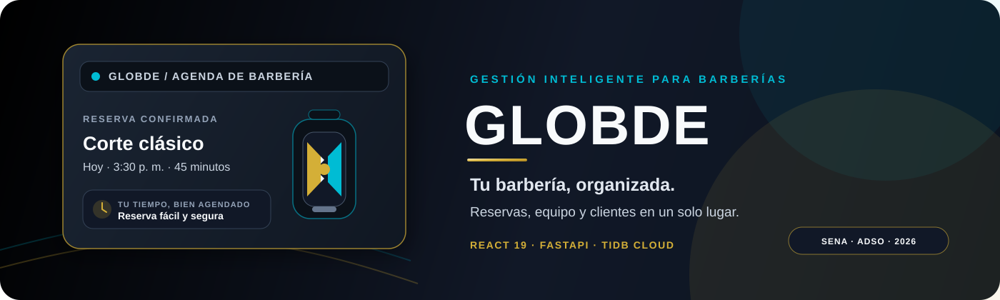

<!--
  ¿Qué? Guía principal del sistema GLOBDE.
  ¿Para qué? Documenta su arquitectura, instalación, uso y validación.
  ¿Impacto? Orienta a los equipos que desarrollan y despliegan el proyecto.
-->

> **Proyecto formativo** — SENA | Programa ADSO (Análisis y Desarrollo de Software)

# 💈 GLOBDE — Gestión moderna para barberías

<p align="center">
  
</p>

Sistema web para organizar reservas, equipo y clientes de una barbería. Construido con **FastAPI (Python 3.13)**, **React 19 + TypeScript + Vite** y **TiDB Cloud** como base de datos relacional.

---

## 🎯 Estado del proyecto (revisión documental y técnica · 26 de noviembre de 2026)

| Área | Estado | Detalle |
| :--- | :---: | :--- |
| **Backend** | ✅ Implementado y verificado | FastAPI con JWT por roles. OpenAPI publica 129 operaciones por defecto (131 con compatibilidad v1). Las 160 pruebas y los jobs de CI pasaron en MySQL desechable. |
| **Frontend ↔ Backend** | ✅ Conectado | Login/registro por JWT, catálogo y citas cargados desde la API, operaciones (crear/editar/cancelar/calificar/canjear) que **persisten en el backend**. Nada vuelve a datos ficticios al recargar. |
| **Frontend** | ✅ Verificado | TypeScript, ESLint y build de Vite pasan; el equipo reporta revisión visual manual completada. |
| **Base de datos** | ✅ TiDB Cloud conectada | La base está alojada en el servidor externo del proyecto; el equipo confirma que la aplicación carga usuarios y datos. |
| **Autenticación** | ✅ | Token persistido en `sessionStorage`, enviado como `Bearer` por `apiClient`. Autorización real por rol en el backend (`SoloAdmin`/`SoloBarbero`/`SoloCliente`); la interfaz solo oculta paneles. |
| **Rutas legacy** | ✅ Apagadas | `ENABLE_LEGACY_ROUTES=false` por defecto. `GET /api/datos` ya no expone datos sin autenticación. |
| **Seguridad** | ✅ | `bcrypt`, consultas parametrizadas, secretos fuera del Compose y archivos `.env` ignorados. |
| **Dependencias** | ✅ Exactas | Backend y frontend 100 % pinados sin comodines (`starlette==1.6.0`, `python-multipart==0.0.32`, etc.). `pip-audit` + `pnpm audit` en el CI. |
| **Requisitos** | ✅ 33/33 con implementación identificada | El código contempla recordatorios periódicos, cierres generales, exportación CSV y lista de espera. CSV está implementado en el cliente (no XLSX); ver [matriz de trazabilidad](docs/requisitos/matriz-trazabilidad.md). La implementación no sustituye pruebas de aceptación integrales. |

---

## ✅ Verificación del proyecto

| Comprobación | Resultado |
|---|---|
| CI GitHub Actions | [Backend y frontend aprobados](https://github.com/JFelipeCa/Globde/actions/runs/45911749824). |
| Pruebas backend | 160 aprobadas: 67 unitarias y 93 de integración en MySQL desechable; cobertura registrada del 69 %. |
| Frontend | Verificaciones de TypeScript, ESLint y build aprobadas. |
| Documentación | Requisitos, arquitectura, API, operación y pruebas organizados en el [índice documental](docs/README.md). |

El alcance de cada verificación y el estado detallado del proyecto están en
[estado-proyecto.md](docs/estado-proyecto.md) y el
[informe de ejecución](docs/pruebas/informe-ejecucion.md).

## 📝 Antes de empezar

Este repositorio reúne la aplicación web de GLOBDE, su API, las migraciones y la documentación funcional y técnica. El backend se conecta a **TiDB Cloud**, alojada de forma remota. Consulta el [estado general del proyecto](docs/estado-proyecto.md) o explora el [índice de documentación](docs/README.md).

## 📚 Documentación del proyecto

La documentación está organizada por área para facilitar la exploración del
producto, su arquitectura y su evolución. El [estado general del proyecto](docs/estado-proyecto.md)
resume las capacidades implementadas, verificaciones disponibles y siguientes
validaciones.

| Área | Documentos principales |
|---|---|
| Producto y requisitos | [Requisitos del sistema](docs/requisitos.md) · [Matriz RF → HU → CU](docs/requisitos/matriz-trazabilidad.md) |
| Arquitectura y diseño | [Arquitectura](docs/referencia-tecnica/architecture.md) · [Modelo de datos](docs/referencia-tecnica/database-schema.md) · [Sistema de diseño](docs/referencia-tecnica/design-system.md) |
| API y operación | [Referencia API REST](docs/referencia-tecnica/api-endpoints.md) · [Guía Docker](docs/setup/con-docker.md) · [Base de datos y migraciones](database/README_DB.md) |
| Calidad | [Plan de pruebas](docs/pruebas/plan-pruebas.md) · [Informe de ejecución](docs/pruebas/informe-ejecucion.md) |

---

## 📋 Tabla de Contenidos

* [💈 GLOBDE — Gestión moderna para barberías](#-globde--gestión-moderna-para-barberías)
  * [✅ Verificación del proyecto](#-verificación-del-proyecto)
  * [📝 Antes de empezar](#-antes-de-empezar)
  * [📚 Documentación del proyecto](#-documentación-del-proyecto)
  * [📋 Tabla de Contenidos](#-tabla-de-contenidos)
  * [🛠️ Stack Tecnológico](#️-stack-tecnológico)
  * [✅ Prerrequisitos](#-prerrequisitos)
  * [🚀 Instalación y Puesta en Marcha](#-instalación-y-puesta-en-marcha)
    * [Opción 1: Con Docker y Docker Compose (Recomendada)](#opción-1-con-docker-y-docker-compose-recomendada)
    * [Opción 2: Instalación Manual (Sin Docker)](#opción-2-instalación-manual-sin-docker)
  * [▶️ Ejecución y Verificación](#️-ejecución-y-verificación)
  * [🧪 Testing y Calidad](#-testing-y-calidad)
  * [📁 Estructura del Proyecto](#-estructura-del-proyecto)
  * [📏 Convenciones y Estándares](#-convenciones-y-estándares)
  * [📚 Documentación Técnica y Requisitos](#-documentación-técnica-y-requisitos)
  * [👥 Roles y Capacidades del Sistema](#-roles-y-capacidades-del-sistema)
  * [🎨 Sistema de Diseño (Design System)](#-sistema-de-diseño-design-system)
  * [🎓 Propósito Educativo SENA](#-propósito-educativo-sena)
  * [⚠️ Exención de Responsabilidades](#️-exención-de-responsabilidades)
  * [📄 Licencia y Equipo](#-licencia-y-equipo)

---

## 🛠️ Stack Tecnológico

| Capa | Tecnologías | Propósito |
| :--- | :--- | :--- |
| **Backend** | Python 3.13+, FastAPI, Uvicorn, Pydantic v2, bcrypt | API REST de alto rendimiento, validación de esquemas y hashing seguro |
| **Frontend** | React 19, TypeScript, Vite, Context API, Tailwind CSS 4 | SPA reactiva, tipado estático estricto, gestión de estado y persistencia |
| **Base de Datos** | TiDB Cloud, MySQL compatible, Alembic | Persistencia relacional alojada remotamente; esquema versionado con migraciones |
| **Email (Dev/Prod)** | Python `smtplib` + MIME (Mailpit en local / SMTP TLS) | Envío de tokens seguros de recuperación de contraseña y alertas |
| **Contenedores** | Docker 24+, Docker Compose v2 | Backend y frontend en contenedores; conexión a la base configurada aparte |
| **Estilos & UI** | Tailwind CSS v4 (`@tailwindcss/vite`), tokens `@theme`, `clsx` + `tailwind-merge` | Diseño responsive mobile-first con temática barbería premium |

La evaluación cualitativa de alternativas de framework backend está en
[Alternativas para el backend](docs/referencia-tecnica/alternativas-backend.md).

---

## ✅ Prerrequisitos

Antes de comenzar, asegúrate de contar con el siguiente software instalado:

| Herramienta | Versión mínima recomendada | Comando de verificación |
| :--- | :--- | :--- |
| **Python** | 3.13+ | `python3 --version` o `python --version` |
| **uv** | 0.5+ | `uv --version` |
| **Node.js** | 22 LTS+ | `node --version` |
| **pnpm** | 11+ | `pnpm --version` |
| **Docker** | 24.0+ | `docker --version` |
| **Docker Compose** | 2.20+ | `docker compose version` |
| **Base de datos** | TiDB Cloud (remota) o MySQL local para desarrollo | La instancia TiDB del proyecto se aloja en un servidor externo; Docker no crea la base |
| **Git** | 2.40+ | `git --version` |

### Instalar `uv`

El backend usa [uv](https://docs.astral.sh/uv/) para gestionar el entorno y las
dependencias. No viene preinstalado en Codespaces ni en la mayoría de sistemas:

```bash
curl -LsSf https://astral.sh/uv/install.sh | sh
source $HOME/.local/bin/env      # o abre una terminal nueva
uv --version
```

Si al correr `uv sync` obtienes `bash: uv: command not found`, es esto: falta
instalarlo, o falta el `source` para que la terminal actual lo encuentre.

> 🖥️ **Usuarios de Windows**: Se recomienda utilizar **Git Bash** o **WSL2** para ejecutar comandos con sintaxis bash uniforme.

---

## 🚀 Instalación y Puesta en Marcha

### Opción 1: Con Docker y Docker Compose (Recomendada)

Levanta el backend FastAPI y el frontend Vite. La base de datos del proyecto es
**TiDB Cloud alojada remotamente en el servidor del equipo**; se accede mediante
variables privadas y no se ejecuta en Docker local. En Codespaces, configura los secretos descritos en
[`docs/setup/con-docker.md`](docs/setup/con-docker.md); para ejecución local,
configura `backend/.env`.
El backend aplica migraciones de Alembic al arrancar; no apuntes este entorno a una
base de producción. Usa la instancia TiDB de desarrollo del equipo y revisa y
aprueba las migraciones antes de integrarlas, porque pueden cambiar el esquema o
los datos compartidos.

```bash
# 1. Clonar el repositorio
git clone https://github.com/JFelipeCa/Globde.git
cd Globde

# 2. Configurar variables privadas del backend
cp backend/.env.example backend/.env
# Fuera de Codespaces, completa los valores privados para la instancia TiDB de desarrollo.
# En Codespaces, configura los secretos indicados en docs/setup/con-docker.md.
# Genera JWT_SECRET con: python -c "import secrets; print(secrets.token_urlsafe(48))"

# 3. Validar configuración y levantar contenedores
bash scripts/start.sh
# El backend conecta a TiDB y ejecuta Alembic al arrancar.

# 4. Listo
# → Frontend:  http://localhost:5173
# → API/Docs:  http://localhost:8000/docs
```

> [!IMPORTANT]
> `backend/.env.example` no contiene credenciales. En Codespaces, los secretos del
> usuario se pasan directamente a Compose; localmente, completa `backend/.env`.
> Guía detallada y troubleshooting: [`docs/setup/con-docker.md`](docs/setup/con-docker.md).

### Opción 2: Instalación Manual (Sin Docker)

```bash
# 1. Base de datos MySQL local
# Crea la base vacía; el esquema lo generan las migraciones de Alembic:
mysql -u root -p -e "CREATE DATABASE globde CHARACTER SET utf8mb4 COLLATE utf8mb4_unicode_ci;"

# 2. Backend (FastAPI)
cd backend
uv sync                         # crea el entorno virtual e instala dependencias
cp .env.example .env            # Configurar DB_HOST, DB_NAME, DB_USER y DB_PASSWORD

uv run alembic upgrade head     # aplica migraciones: 26 tablas, 4 vistas y semillas

uv run uvicorn app.main:app --reload --host 0.0.0.0 --port 8000
# → API disponible en: http://localhost:8000
# → Documentación Swagger interactiva: http://localhost:8000/docs

# 3. Frontend (React + Vite)
cd ../frontend
pnpm install
pnpm run dev
# → Aplicación disponible en: http://localhost:5173
```

---

## ▶️ Ejecución y Verificación

| Servicio | URL Local | Descripción |
| :--- | :--- | :--- |
| **Frontend Web** | `http://localhost:5173` | Landing page, Catálogo, Login, Dashboards Cliente/Barbero/Admin |
| **Backend REST API** | `http://localhost:8000` | Punto de entrada FastAPI con endpoints versionados `/api/` |
| **Documentación Swagger** | `http://localhost:8000/docs` | Interfaz interactiva OpenAPI para pruebas de endpoints |
| **Documentación ReDoc** | `http://localhost:8000/redoc` | Especificación técnica OpenAPI en formato ReDoc |
| **Base de datos** | TiDB Cloud remota | Según las variables privadas de `backend/.env`; no se publica el host ni las credenciales |

---

## 🧪 Testing y Calidad

### Backend (Python + pytest)

```bash
cd backend
uv sync                        # instala dependencias (incluye el grupo dev)
uv run pytest tests/test_unitarias.py              # 67 pruebas sin base de datos
uv run pytest --cov=app --cov-report=term-missing  # Suite completa; requiere MySQL de pruebas aislada
```

Con Docker, sin instalar nada en el host:

> No ejecutes las pruebas de integración dentro del contenedor si `backend/.env`
> apunta a la TiDB compartida: pueden modificar datos. Para la suite completa usa
> una base de pruebas aislada. El CI crea MySQL efímero; ver
> [plan de pruebas](docs/pruebas/plan-pruebas.md).

> [!IMPORTANT]
> La suite completa incluye 160 casos recopilados: 67 unitarios y 93 de integración.
> El 26 de noviembre de 2026, los 160 pasaron con MySQL 8.0.46 desechable y
> cobertura del 69 %. Ejecuta integración solo contra una base de pruebas aislada,
> nunca contra la base compartida o de producción. Consulta el
> [plan](docs/pruebas/plan-pruebas.md) y el
> [informe de ejecución](docs/pruebas/informe-ejecucion.md).

### Frontend (React + TypeScript)

```bash
cd frontend
pnpm install --frozen-lockfile
pnpm exec tsc -b --force       # verificación de tipos estricta
pnpm run lint                  # ESLint
pnpm run build                 # build de producción
pnpm audit --audit-level high  # auditoría de vulnerabilidades
```

### Integración Continua

Los push a `main`, `develop` y `feature/**`, y los PR hacia `main` o `develop`, ejecutan
[`.github/workflows/ci.yml`](.github/workflows/ci.yml): levantan MySQL como servicio,
aplican las migraciones, corren las pruebas con cobertura y verifican tipos, lint y build del frontend.
El workflow **falla si alguna prueba queda en `skipped`**, para que no pasen inadvertidas.
El reporte HTML de cobertura queda como artifact `htmlcov` durante 14 días.

---

## 📁 Estructura del Proyecto

```
Globde/
├── .github/
│   └── workflows/
│       └── ci.yml                    # CI: pruebas con MySQL, cobertura y build del frontend
├── .gitignore                        # Archivos y secretos ignorados por Git
├── docker-compose.yml                # Orquestación de backend y frontend; la BD se configura aparte
├── README.md                         # Documento maestro del proyecto (este archivo)
├── database/
│   └── database.sql                  # Referencia histórica del modelo (el esquema lo crea Alembic)
├── backend/                          # Backend — FastAPI + Python 3.13
│   ├── app/
│   │   ├── main.py                   # Arranque de FastAPI, montaje de routers, CORS
│   │   ├── routers/                  # 15 routers de dominio; legacy opcional
│   │   ├── services/                 # Reglas de negocio + acceso a datos (SQL puro)
│   │   ├── schemas/                  # Modelos Pydantic de entrada/salida
│   │   └── core/                     # Config, seguridad (JWT/bcrypt), excepciones
│   ├── alembic/                      # Migraciones: fuente de verdad del esquema de BD
│   │   └── versions/                 # Migraciones hasta h8b9c0d1e2f3 (26 tablas + 4 vistas)
│   ├── alembic.ini                   # Configuración de Alembic
│   ├── docker-entrypoint.sh          # Conecta a la BD configurada y ejecuta Alembic
│   ├── tests/                        # pytest (160 casos recopilados; unitarias e integración)
│   ├── .env.example                  # Plantilla de variables de entorno seguras
│   ├── Dockerfile                    # Imagen Docker de producción backend
│   ├── pyproject.toml                # Dependencias de Python (gestionadas con uv)
│   └── uv.lock                       # Lockfile reproducible
├── frontend/                         # Frontend — React 19 + Vite + TypeScript
│   ├── src/
│   │   ├── context/                  # AppContext: estado global vía React Context API
│   │   ├── components/ui/            # Navbar, modales (Auth, Ticket), wizard de reservas
│   │   ├── components/sections/      # Secciones de la landing (Hero, Servicios, Barberos...)
│   │   ├── components/paneles/       # Dashboards por rol (Cliente, Barbero, Admin)
│   │   ├── types/index.ts            # Contratos y tipos TypeScript globales
│   │   └── utils/                    # apiClient (fetch), formateadores de fecha y moneda
│   ├── package.json                  # Dependencias de Node.js
│   └── vite.config.ts                # Configuración del bundler Vite
└── docs/                             # Documentación Técnica Completa
    ├── README.md                     # Índice de documentación del proyecto
    ├── estado-proyecto.md            # Estado funcional, verificaciones y siguientes pasos
    ├── requisitos.md                 # Índice de requisitos del sistema
    ├── requisitos/
    │   ├── RFs/                      # 16 Requisitos Funcionales agrupados
    │   ├── HUs/                      # 33 Historias de Usuario con criterios de aceptación
    │   ├── CUs/                      # 33 Casos de Uso con diagramas de flujo Mermaid
    │   └── restricciones.md          # Restricciones técnicas, de negocio, legales y operativas
    ├── referencia-tecnica/
    │   ├── architecture.md           # Arquitectura en 3 capas, flujo de datos y diagramas
    │   ├── database-schema.md        # Modelo ER, clases y diccionario de 26 tablas + 4 vistas
    │   ├── api-endpoints.md          # Catálogo exhaustivo de endpoints, payloads y respuestas
    │   └── design-system.md          # Tokens de diseño, paleta, componentes y estados
    ├── conceptos/
    │   ├── patrones-arquitectonicos.md # 10 patrones arquitectónicos aplicados en Globde
    │   ├── owasp-top-10.md           # Mitigación del OWASP Top 10 aplicada al sistema
    │   └── accesibilidad-aria-wcag.md # Estándares WCAG 2.1 AA y ARIA en la UI
    ├── setup/
    │   ├── con-docker.md             # Guía detallada con Docker y Troubleshooting
    │   └── sin-docker.md             # Guía detallada manual paso a paso
    ├── pruebas/                      # Plan e informe de ejecución
    └── anexos/                       # Material de referencia y anexos del proyecto
```

---

## 📏 Convenciones y Estándares

| Aspecto | Convención adoptada |
| :--- | :--- |
| **Nomenclatura backend** | Endpoints REST en minúsculas en español/inglés estandarizado (`/api/citas`, `/api/auth/login`), variables snake_case |
| **Nomenclatura frontend** | Componentes en PascalCase (`PanelAdmin.tsx`), hooks en camelCase (`useApp`), tipos en PascalCase |
| **Encabezados pedagógicos** | Todos los archivos de documentación inician con `<!-- ¿Qué? ¿Para qué? ¿Impacto? -->` |
| **Commits** | Conventional Commits con formato semántico y justificación: `feat(citas): agregar validacion de traslape` |
| **Seguridad de contraseñas**| Hashing obligatorio con **bcrypt** (salt rounds integrados). Nunca en texto plano |
| **Variables de entorno** | Ningún secreto hardcodeado; uso estricto de `.env` ignorado por Git con plantilla `.env.example` |

---

## 📚 Documentación Técnica y Requisitos

Accede a la documentación completa según la necesidad:

| Documento | Ubicación | Descripción |
| :--- | :--- | :--- |
| **📚 Índice de documentación** | [`docs/README.md`](docs/README.md) | **Punto de entrada:** mapa de todos los documentos y su estado |
| **Estado del proyecto** | [`docs/estado-proyecto.md`](docs/estado-proyecto.md) | Capacidades implementadas, verificaciones y próximos pasos |
| **Plan de pruebas** | [`docs/pruebas/plan-pruebas.md`](docs/pruebas/plan-pruebas.md) | Alcance, niveles y ambiente aislado |
| **Informe de pruebas** | [`docs/pruebas/informe-ejecucion.md`](docs/pruebas/informe-ejecucion.md) | Ejecuciones verificadas, límites y defectos abiertos |
| **Índice de Requisitos** | [`docs/requisitos.md`](docs/requisitos.md) | Las 33 HUs enlazadas con sus 33 CUs, agrupadas por módulo |
| **Requisitos Funcionales (RFs)**| [`docs/requisitos/RFs/`](docs/requisitos/RFs/) | 16 requisitos funcionales agrupados con entradas, proceso, salidas y reglas |
| **Historias de Usuario (HUs)** | [`docs/requisitos/HUs/`](docs/requisitos/HUs/) | 33 HUs con criterios de aceptación `Dado que / Cuando / Entonces` |
| **Casos de Uso (CUs)** | [`docs/requisitos/CUs/`](docs/requisitos/CUs/) | 33 CUs con secuencias normales, excepciones y diagramas Mermaid |
| **Restricciones del Sistema** | [`docs/requisitos/restricciones.md`](docs/requisitos/restricciones.md) | Restricciones normativas (Ley 1581 Habeas Data), técnicas y de negocio |
| **Migraciones de BD** | [`backend/alembic/README.md`](backend/alembic/README.md) | Uso diario de Alembic, crear migraciones y particularidades de MySQL |
| **Arquitectura de Software** | [`docs/referencia-tecnica/architecture.md`](docs/referencia-tecnica/architecture.md) | Arquitectura en 3 capas, flujo cliente-servidor y decisiones técnicas |
| **Esquema de Base de Datos** | [`docs/referencia-tecnica/database-schema.md`](docs/referencia-tecnica/database-schema.md) | Modelo ER, 26 tablas, 4 vistas SQL, claves foráneas e índices |
| **Referencia de API REST** | [`docs/referencia-tecnica/api-endpoints.md`](docs/referencia-tecnica/api-endpoints.md) | Catálogo de 129 operaciones por defecto: método, ruta, autorización, paginación y errores |
| **Design System** | [`docs/referencia-tecnica/design-system.md`](docs/referencia-tecnica/design-system.md) | Tokens de Tailwind v4, paleta negro/blanco/dorado, clases propias y deuda de estilos |
| **Patrones Arquitectónicos** | [`docs/conceptos/patrones-arquitectonicos.md`](docs/conceptos/patrones-arquitectonicos.md) | 10 patrones aplicados (MVC/Capas, DTO, Context API, Component-Driven UI...) |
| **Seguridad OWASP Top 10** | [`docs/conceptos/owasp-top-10.md`](docs/conceptos/owasp-top-10.md) | Análisis y mitigación de vulnerabilidades OWASP 2021 en Globde |
| **Accesibilidad WCAG / ARIA** | [`docs/conceptos/accesibilidad-aria-wcag.md`](docs/conceptos/accesibilidad-aria-wcag.md) | Cumplimiento de estándares de accesibilidad e inclusión web |
| **Guía de Setup Docker** | [`docs/setup/con-docker.md`](docs/setup/con-docker.md) | Despliegue en contenedores, variables y resolución de problemas |
| **Guía de Setup Manual** | [`docs/setup/sin-docker.md`](docs/setup/sin-docker.md) | Configuración manual en entornos locales |
| **Índice documental** | [`docs/README.md`](docs/README.md) | Mapa completo de documentación funcional, técnica y operativa |

---

## 👥 Roles y Capacidades del Sistema

```
┌────────────────────────────────────────────────────────────────────────┐
│                        ROLES DE USUARIO EN GLOBDE                      │
├───────────────────┬──────────────────────────┬─────────────────────────┤
│ 🧑‍💼 ADMINISTRADOR   │ 💈 BARBERO               │ 🙋 CLIENTE              │
│ (Rol ID = 1)      │ (Rol ID = 2)             │ (Rol ID = 3)            │
├───────────────────┼──────────────────────────┼─────────────────────────┤
│ • Gestión total   │ • Visualización de su    │ • Registro y perfil     │
│   de usuarios     │   agenda diaria          │   autónomo              │
│ • Administración  │ • Agendamiento manual    │ • Catálogo de servicios │
│   de servicios    │   en el salón            │   con precios y tiempos │
│ • Control de      │ • Cambio de estado de    │ • Reserva de citas      │
│   clientes        │   citas (en atención,    │   en tiempo real        │
│ • Asignación de   │   completada)            │ • Cancelación de citas  │
│   barberos        │ • Consulta de su         │   oportuna              │
│ • Reportes de     │   ranking y desempeño    │ • Historial de visitas  │
│   ingresos/citas  │ • Configuración de       │ • Calificación del      │
│ • Configuración   │   disponibilidad         │   servicio prestado     │
│   de fidelización │ • Visualización de       │ • Acumulación y saldo   │
│ • Días festivos   │   comisiones estimadas   │   de puntos de lealtad  │
└───────────────────┴──────────────────────────┴─────────────────────────┘
```

---

## 🎨 Sistema de Diseño (Design System)

La interfaz actual usa una base clara con acentos dorados y conserva colores
literales y remapeos CSS pendientes de normalización. La [referencia técnica del
design system](docs/referencia-tecnica/design-system.md) describe los tokens
reales y la deuda vigente; evita usar la paleta cian/oscura de versiones anteriores.

---

## 🎓 Propósito Educativo SENA

Este proyecto fue desarrollado en el marco del programa **Tecnólogo en Análisis y Desarrollo de Software (ADSO)** del SENA. Su objetivo es evidenciar el dominio integral de las fases de ingeniería de software:

1. **Análisis y Especificación**: Levantamiento de requisitos formales (RF, HU, CU, RNF, Restricciones).
2. **Diseño de Software y Datos**: Modelado Entidad-Relación, normalización de base de datos y arquitectura en capas.
3. **Construcción y Desarrollo**: Implementación backend con FastAPI y frontend con React + Context API + TypeScript.
4. **Seguridad y Calidad**: Hashing de credenciales, mitigación de riesgos OWASP, accesibilidad WCAG y manejo de excepciones.

---

## ⚠️ Exención de Responsabilidades

Este software fue desarrollado con fines **formativos y educativos**:

* **Entorno Académico**: No debe ser expuesto en entornos de producción con datos reales sin antes incorporar pasarelas de pago cifradas, certificados SSL/TLS y auditorías de seguridad avanzadas.
* **Credenciales de Ejemplo**: Los valores presentes en `.env.example` son únicamente ilustrativos.
* **Protección de Datos Personales**: El sistema implementa principios de la **Ley 1581 de 2012 de Habeas Data** (Colombia) para el tratamiento de datos de contacto de clientes.

---

## 📄 Licencia y Equipo

### Licencia
Este proyecto está licenciado bajo [Creative Commons Atribución-NoComercial-CompartirIgual 4.0 Internacional (CC BY-NC-SA 4.0)](https://creativecommons.org/licenses/by-nc-sa/4.0/deed.es). Eres libre de compartir y adaptar el material para fines educativos no comerciales dando el debido crédito.

### Equipo de Desarrollo — SENA ADSO 2026

| Nombre del Aprendiz | Rol Principal en el Proyecto |
| :--- | :--- |
| **Laura** | Diseño y Administración de Base de Datos (DBA / Data Modeling) |
| **Juan Felipe Cañón** | Desarrollo Backend (FastAPI, Integración MySQL, Autenticación y Endpoints) |
| **Dayanna Patiño** | Desarrollo Frontend (React, TypeScript, Context API, UI/UX & Responsive) |

---
*Globde — Excelencia en la gestión de servicios y barbería.*
