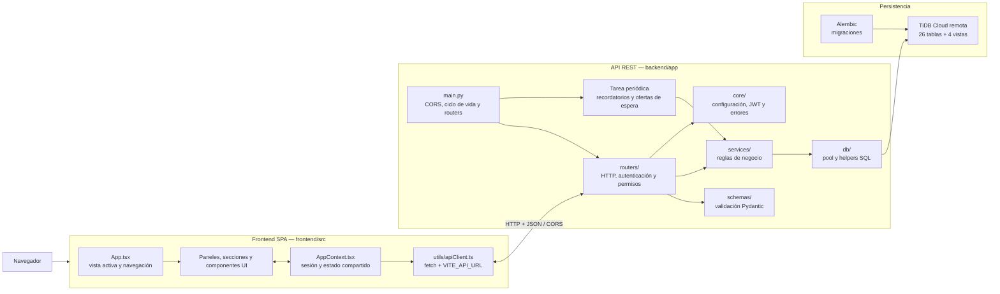
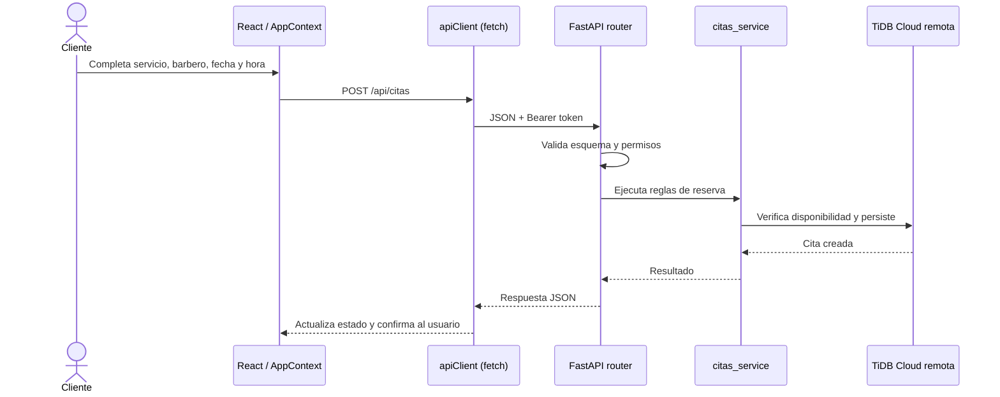

<!--
  ¿Qué? Describe la arquitectura desplegada de GLOBDE y el flujo entre sus componentes.
  ¿Para qué? Facilita explicar y mantener las responsabilidades del frontend, API y persistencia.
  ¿Impacto? Evita decisiones basadas en el diseño inicial que ya no coincide con el código.
-->

# Arquitectura del sistema — GLOBDE

> **Revisión:** 26 de noviembre de 2026
> **Estilo:** cliente-servidor, SPA + API REST + base de datos relacional
> **Frontend:** React 19, TypeScript, Vite 7, Tailwind CSS 4 y Context API
> **Backend:** FastAPI, Pydantic 2, Uvicorn y `mysql-connector-python`
> **Persistencia:** TiDB Cloud remota (compatible con MySQL); esquema versionado con Alembic

## Diagrama de arquitectura

## Responsabilidades por capa

| Capa | Responsabilidades | Componentes principales |
|---|---|---|
| Presentación | Landing, paneles por rol, formularios, navegación y estado de sesión | `App.tsx`, `AppContext.tsx`, `components/`, `utils/apiClient.ts` |
| API y aplicación | Validación de entrada, autenticación JWT, autorización, reglas de negocio y respuestas HTTP | `routers/`, `schemas/`, `services/`, `core/` |
| Persistencia | Consultas parametrizadas, pool de conexiones y esquema relacional | `db/`, MySQL/TiDB, `alembic/versions/` |

El backend separa transporte y negocio: los routers llaman a servicios, y los
servicios acceden a la base mediante los helpers de `app/db/`. Las consultas de
la aplicación usan parámetros; Alembic es la fuente de verdad del esquema.
`database/database.sql` se conserva como referencia histórica, no como
migración ejecutable.

## Flujo de reserva de una cita

## Procesos periódicos

Durante el ciclo de vida de FastAPI se ejecuta una tarea de fondo cada 60
segundos. Procesa recordatorios de citas y ofertas compatibles de la lista de
espera. Los errores se registran en el log; el envío de correo depende de la
configuración SMTP y no debe darse por probado solo porque la tarea exista.

## Navegación y estado del frontend

La aplicación no usa React Router: `App.tsx` muestra las vistas según el estado
de `AppContext`. El contexto centraliza la sesión y datos compartidos; las
llamadas HTTP pasan por `utils/apiClient.ts`, basado en `fetch`. Las rutas de
pantalla y los permisos de servidor son responsabilidades distintas: ocultar
una acción en la UI no reemplaza la autorización de la API.

## Configuración de despliegue

- **Desarrollo con Docker Compose:** inicia backend y frontend; la base de datos
  se configura aparte mediante las variables privadas de conexión a TiDB Cloud.
- **Desarrollo manual:** frontend Vite y API Uvicorn locales, con MySQL accesible.
- **Compose de producción:** configura el servicio MySQL, API y frontend estático
  con Nginx; usa variables privadas de entorno.

Las guías de configuración están en [`../setup/con-docker.md`](../setup/con-docker.md)
y [`../setup/sin-docker.md`](../setup/sin-docker.md). No apuntes una ejecución de
pruebas a la instancia compartida o productiva.

## Decisiones arquitectónicas

| Decisión | Motivo / límite |
|---|---|
| FastAPI + Pydantic | API tipada y contrato OpenAPI generado; requiere mantener `/docs` alineado con el consumo real. |
| Context API | Estado compartido sin un gestor externo; no sustituye un enrutador ni una capa de caché. |
| Base relacional | Citas, usuarios, servicios y facturas requieren relaciones e integridad referencial. |
| Servicios separados de routers | Mantiene reglas de negocio fuera de la capa HTTP y facilita pruebas. |
| Alembic | Permite aplicar y revertir cambios versionados; `database.sql` no es fuente de verdad. |

## Diagrama entidad-relación

El modelo relacional y las relaciones principales se documentan en
[`database-schema.md`](database-schema.md), contrastado con las migraciones
vigentes y no solo con la revisión inicial.
