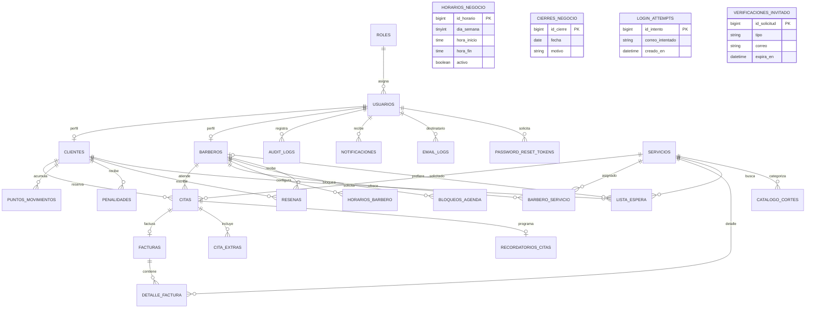
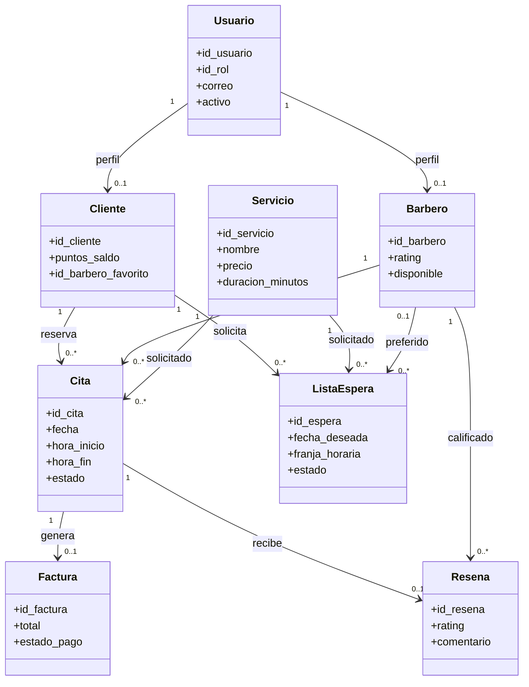

# Esquema de Base de Datos — GLOBDE

<!--
  ¿Qué? Documentación técnica exhaustiva del modelo relacional de datos de GLOBDE.
  ¿Para qué? Proveer el diccionario de datos, relaciones de claves foráneas, restricciones de integridad
             y vistas SQL para cualquier desarrollador o auditor del sistema.
  ¿Impacto? Garantiza la correcta interacción con la base de datos sin incurrir en violaciones de integridad referencial.
-->

> **Motor del proyecto**: TiDB Cloud (compatible con MySQL), alojada remotamente
> **Motor en CI**: MySQL 8.0; la compatibilidad con otros motores requiere validación específica
> **Nombre de Base de Datos**: `globde`  
> **Fuente de verdad del esquema**: migraciones de Alembic en `backend/alembic/versions/`  
> **Revisión inicial**: `dd2ee59368e5_esquema_inicial`
> **Revisión vigente**: `h8b9c0d1e2f3_invitados_verificados`
> **Tablas relacionales vigentes**: 26
> **Vistas SQL**: 4

> [!IMPORTANT]
> El esquema **no se crea con `database/database.sql`**. Ese archivo se conserva
> únicamente como referencia histórica. El esquema real se crea y versiona con Alembic:
> `alembic upgrade head` (también durante el arranque del contenedor `backend`).
> El entorno del equipo usa TiDB Cloud; Docker Compose no levanta ni contiene esa base.
> El diccionario cubre las 20 tablas de la revisión inicial y las seis tablas añadidas
> por revisiones posteriores; las columnas evolucionadas se indican en la tabla de cambios.

---

## 1. Diagrama Entidad-Relación (ER)

Diagrama lógico de las tablas persistentes vigentes. Los campos y restricciones
completos se definen en Alembic.



`v_citas_detalle`, `v_dashboard_admin`, `v_ranking_barberos` y
`v_resumen_clientes` son vistas, no tablas. `HORARIOS_NEGOCIO` y
`CIERRES_NEGOCIO` almacenan configuración global; `VERIFICACIONES_INVITADO`
conserva solicitudes temporales de verificación.

## Diagrama de clases del dominio

Vista conceptual de las entidades y asociaciones principales. No representa
clases Python ni un ORM: el backend valida con Pydantic y persiste mediante SQL.



---


## 2. Diccionario de Datos (26 Tablas)

> Generado a partir de `backend/alembic/versions/dd2ee59368e5_esquema_inicial.py`.


### 2.1 Tabla `roles`

| Columna | Tipo | Nulo | Default | Notas |
|---|---|---|---|---|
| `id_rol` | TINYINT(3) UNSIGNED | No | — | AUTO_INCREMENT |
| `nombre` | VARCHAR(50) | No | — | — |
| `descripcion` | VARCHAR(180) | No | — | — |
| `activo` | TINYINT(1) | No | `1` | — |
| `creado_en` | DATETIME | No | `current_timestamp()` | — |

- **PK:** `id_rol`
- **UNIQUE INDEX** `uq_roles_nombre` (nombre)

### 2.2 Tabla `servicios`

| Columna | Tipo | Nulo | Default | Notas |
|---|---|---|---|---|
| `id_servicio` | BIGINT(20) UNSIGNED | No | — | AUTO_INCREMENT |
| `nombre` | VARCHAR(120) | No | — | — |
| `categoria` | ENUM('Cortes','Barba','Combos','Tratamientos','Infantil') | No | `Cortes` | — |
| `precio` | DECIMAL(10, 2) | No | — | — |
| `duracion_minutos` | SMALLINT(5) UNSIGNED | No | — | — |
| `puntos_otorga` | INTEGER(10) UNSIGNED | No | `0` | — |
| `popular` | TINYINT(1) | No | `0` | — |
| `activo` | TINYINT(1) | No | `1` | — |
| `creado_en` | DATETIME | No | `current_timestamp()` | — |
| `descripcion` | TEXT | Sí | — | — |
| `icono` | VARCHAR(80) | Sí | — | — |
| `imagen_url` | VARCHAR(255) | Sí | — | — |
| `actualizado_en` | DATETIME | Sí | `NULL ON UPDATE current_timestamp()` | — |

- **PK:** `id_servicio`
- **CHECK** `chk_servicios_duracion`: ``duracion_minutos` > 0`
- **CHECK** `chk_servicios_precio`: ``precio` > 0`
- **ÍNDICE** `idx_servicios_activo` (activo)
- **ÍNDICE** `idx_servicios_categoria` (categoria)
- **ÍNDICE** `idx_servicios_popular` (popular)
- **UNIQUE INDEX** `uq_servicios_nombre` (nombre)

### 2.3 Tabla `catalogo_cortes`

| Columna | Tipo | Nulo | Default | Notas |
|---|---|---|---|---|
| `id_corte` | BIGINT(20) UNSIGNED | No | — | AUTO_INCREMENT |
| `nombre` | VARCHAR(120) | No | — | — |
| `popular` | TINYINT(1) | No | `0` | — |
| `activo` | TINYINT(1) | No | `1` | — |
| `creado_en` | DATETIME | No | `current_timestamp()` | — |
| `id_servicio` | BIGINT(20) UNSIGNED | Sí | — | — |
| `categoria` | VARCHAR(80) | Sí | — | — |
| `descripcion` | TEXT | Sí | — | — |
| `imagen_url` | VARCHAR(255) | Sí | — | — |
| `actualizado_en` | DATETIME | Sí | `NULL ON UPDATE current_timestamp()` | — |

- **PK:** `id_corte`
- **FK:** `id_servicio` → `servicios.id_servicio` (ON DELETE SET NULL, ON UPDATE CASCADE)
- **ÍNDICE** `idx_catalogo_activo` (activo)
- **ÍNDICE** `idx_catalogo_categoria` (categoria)
- **ÍNDICE** `idx_catalogo_popular` (popular)
- **ÍNDICE** `idx_catalogo_servicio` (id_servicio)

### 2.4 Tabla `usuarios`

| Columna | Tipo | Nulo | Default | Notas |
|---|---|---|---|---|
| `id_usuario` | BIGINT(20) UNSIGNED | No | — | AUTO_INCREMENT |
| `id_rol` | TINYINT(3) UNSIGNED | No | — | — |
| `nombre` | VARCHAR(120) | No | — | — |
| `correo` | VARCHAR(180) | No | — | — |
| `contrasena_hash` | VARCHAR(255) | No | — | — |
| `activo` | TINYINT(1) | No | `1` | — |
| `creado_en` | DATETIME | No | `current_timestamp()` | — |
| `telefono` | VARCHAR(25) | Sí | — | — |
| `avatar_url` | VARCHAR(255) | Sí | — | — |
| `email_verificado_at` | DATETIME | Sí | — | — |
| `ultimo_login_at` | DATETIME | Sí | — | — |
| `actualizado_en` | DATETIME | Sí | `NULL ON UPDATE current_timestamp()` | — |

- **PK:** `id_usuario`
- **FK:** `id_rol` → `roles.id_rol` (ON UPDATE CASCADE)
- **ÍNDICE** `idx_usuarios_activo` (activo)
- **ÍNDICE** `idx_usuarios_nombre` (nombre)
- **ÍNDICE** `idx_usuarios_rol` (id_rol)
- **UNIQUE INDEX** `uq_usuarios_correo` (correo)

### 2.5 Tabla `audit_logs`

| Columna | Tipo | Nulo | Default | Notas |
|---|---|---|---|---|
| `id_audit` | BIGINT(20) UNSIGNED | No | — | AUTO_INCREMENT |
| `accion` | VARCHAR(100) | No | — | — |
| `entidad` | VARCHAR(100) | No | — | — |
| `creado_en` | DATETIME | No | `current_timestamp()` | — |
| `id_usuario` | BIGINT(20) UNSIGNED | Sí | — | — |
| `entidad_id` | BIGINT(20) UNSIGNED | Sí | — | — |
| `ip` | VARCHAR(45) | Sí | — | — |
| `user_agent` | VARCHAR(255) | Sí | — | — |
| `detalles` | LONGTEXT CHARACTER SET utf8mb4 COLLATE utf8mb4_bin | Sí | — | — |

- **PK:** `id_audit`
- **FK:** `id_usuario` → `usuarios.id_usuario` (ON DELETE SET NULL, ON UPDATE CASCADE)
- **ÍNDICE** `idx_audit_accion` (accion)
- **ÍNDICE** `idx_audit_entidad` (entidad, entidad_id)
- **ÍNDICE** `idx_audit_fecha` (creado_en)
- **ÍNDICE** `idx_audit_usuario` (id_usuario)

### 2.6 Tabla `barberos`

| Columna | Tipo | Nulo | Default | Notas |
|---|---|---|---|---|
| `id_barbero` | BIGINT(20) UNSIGNED | No | — | AUTO_INCREMENT |
| `id_usuario` | BIGINT(20) UNSIGNED | No | — | — |
| `titulo` | VARCHAR(80) | No | `Barbero` | — |
| `experiencia_anios` | TINYINT(3) UNSIGNED | No | `0` | — |
| `rating` | DECIMAL(3, 2) | No | `0.00` | — |
| `total_resenas` | INTEGER(10) UNSIGNED | No | `0` | — |
| `citas_completadas` | INTEGER(10) UNSIGNED | No | `0` | — |
| `disponible` | TINYINT(1) | No | `1` | — |
| `creado_en` | DATETIME | No | `current_timestamp()` | — |
| `bio` | TEXT | Sí | — | — |
| `foto_url` | VARCHAR(255) | Sí | — | — |
| `color` | VARCHAR(20) | Sí | — | — |
| `actualizado_en` | DATETIME | Sí | `NULL ON UPDATE current_timestamp()` | — |

- **PK:** `id_barbero`
- **FK:** `id_usuario` → `usuarios.id_usuario` (ON DELETE CASCADE, ON UPDATE CASCADE)
- **CHECK** `chk_barberos_rating`: ``rating` >= 0 and `rating` <= 5`
- **ÍNDICE** `idx_barberos_disponible` (disponible)
- **ÍNDICE** `idx_barberos_rating` (rating)
- **UNIQUE INDEX** `uq_barberos_usuario` (id_usuario)

### 2.7 Tabla `clientes`

| Columna | Tipo | Nulo | Default | Notas |
|---|---|---|---|---|
| `id_cliente` | BIGINT(20) UNSIGNED | No | — | AUTO_INCREMENT |
| `id_usuario` | BIGINT(20) UNSIGNED | No | — | — |
| `puntos_saldo` | INTEGER(10) UNSIGNED | No | `0` | — |
| `nivel_fidelizacion` | ENUM('Bronce','Plata','Oro','Diamante') | No | `Bronce` | — |
| `fecha_registro` | DATETIME | No | `current_timestamp()` | — |
| `creado_en` | DATETIME | No | `current_timestamp()` | — |
| `actualizado_en` | DATETIME | Sí | `NULL ON UPDATE current_timestamp()` | — |

- **PK:** `id_cliente`
- **FK:** `id_usuario` → `usuarios.id_usuario` (ON DELETE CASCADE, ON UPDATE CASCADE)
- **ÍNDICE** `idx_clientes_nivel` (nivel_fidelizacion)
- **ÍNDICE** `idx_clientes_puntos` (puntos_saldo)
- **UNIQUE INDEX** `uq_clientes_usuario` (id_usuario)

### 2.8 Tabla `email_logs`

| Columna | Tipo | Nulo | Default | Notas |
|---|---|---|---|---|
| `id_email` | BIGINT(20) UNSIGNED | No | — | AUTO_INCREMENT |
| `destinatario` | VARCHAR(180) | No | — | — |
| `tipo` | ENUM('password_reset','email_verification','confirmacion_cita','cancelacion_cita','recordatorio_cita','factura','notificacion_sistema') | No | — | — |
| `asunto` | VARCHAR(200) | No | — | — |
| `estado` | ENUM('pendiente','enviado','fallido') | No | `pendiente` | — |
| `creado_en` | DATETIME | No | `current_timestamp()` | — |
| `id_usuario` | BIGINT(20) UNSIGNED | Sí | — | — |
| `proveedor` | VARCHAR(80) | Sí | — | — |
| `error` | TEXT | Sí | — | — |
| `enviado_en` | DATETIME | Sí | — | — |

- **PK:** `id_email`
- **FK:** `id_usuario` → `usuarios.id_usuario` (ON DELETE SET NULL, ON UPDATE CASCADE)
- **ÍNDICE** `idx_email_creado` (creado_en)
- **ÍNDICE** `idx_email_destinatario` (destinatario)
- **ÍNDICE** `idx_email_tipo_estado` (tipo, estado)
- **ÍNDICE** `idx_email_usuario` (id_usuario)

### 2.9 Tabla `login_attempts`

| Columna | Tipo | Nulo | Default | Notas |
|---|---|---|---|---|
| `id_attempt` | BIGINT(20) UNSIGNED | No | — | AUTO_INCREMENT |
| `correo_intentado` | VARCHAR(180) | No | — | — |
| `exitoso` | TINYINT(1) | No | `0` | — |
| `creado_en` | DATETIME | No | `current_timestamp()` | — |
| `id_usuario` | BIGINT(20) UNSIGNED | Sí | — | — |
| `motivo` | VARCHAR(120) | Sí | — | — |
| `ip` | VARCHAR(45) | Sí | — | — |
| `user_agent` | VARCHAR(255) | Sí | — | — |

- **PK:** `id_attempt`
- **FK:** `id_usuario` → `usuarios.id_usuario` (ON DELETE SET NULL, ON UPDATE CASCADE)
- **ÍNDICE** `idx_login_correo` (correo_intentado)
- **ÍNDICE** `idx_login_exitoso` (exitoso)
- **ÍNDICE** `idx_login_fecha` (creado_en)
- **ÍNDICE** `idx_login_ip` (ip)
- **ÍNDICE** `idx_login_usuario` (id_usuario)

### 2.10 Tabla `notificaciones`

| Columna | Tipo | Nulo | Default | Notas |
|---|---|---|---|---|
| `id_notificacion` | BIGINT(20) UNSIGNED | No | — | AUTO_INCREMENT |
| `id_usuario` | BIGINT(20) UNSIGNED | No | — | — |
| `tipo` | ENUM('cita','pago','puntos','resena','seguridad','sistema') | No | `sistema` | — |
| `titulo` | VARCHAR(160) | No | — | — |
| `mensaje` | TEXT | No | — | — |
| `leida` | TINYINT(1) | No | `0` | — |
| `creado_en` | DATETIME | No | `current_timestamp()` | — |
| `leida_en` | DATETIME | Sí | — | — |
| `url_accion` | VARCHAR(255) | Sí | — | — |

- **PK:** `id_notificacion`
- **FK:** `id_usuario` → `usuarios.id_usuario` (ON DELETE CASCADE, ON UPDATE CASCADE)
- **ÍNDICE** `idx_notificaciones_fecha` (creado_en)
- **ÍNDICE** `idx_notificaciones_leida` (leida)
- **ÍNDICE** `idx_notificaciones_tipo` (tipo)
- **ÍNDICE** `idx_notificaciones_usuario` (id_usuario)

### 2.11 Tabla `password_reset_tokens`

| Columna | Tipo | Nulo | Default | Notas |
|---|---|---|---|---|
| `id_token` | BIGINT(20) UNSIGNED | No | — | AUTO_INCREMENT |
| `id_usuario` | BIGINT(20) UNSIGNED | No | — | — |
| `token_hash` | CHAR(64) | No | — | — |
| `expires_at` | DATETIME | No | — | — |
| `creado_en` | DATETIME | No | `current_timestamp()` | — |
| `used_at` | DATETIME | Sí | — | — |
| `request_ip` | VARCHAR(45) | Sí | — | — |
| `user_agent` | VARCHAR(255) | Sí | — | — |

- **PK:** `id_token`
- **FK:** `id_usuario` → `usuarios.id_usuario` (ON DELETE CASCADE, ON UPDATE CASCADE)
- **CHECK** `chk_password_reset_fechas`: ``expires_at` > `creado_en``
- **ÍNDICE** `idx_password_reset_created` (creado_en)
- **ÍNDICE** `idx_password_reset_expires` (expires_at)
- **ÍNDICE** `idx_password_reset_used` (used_at)
- **ÍNDICE** `idx_password_reset_usuario` (id_usuario)
- **UNIQUE INDEX** `uq_password_reset_token_hash` (token_hash)

### 2.12 Tabla `barbero_servicio`

| Columna | Tipo | Nulo | Default | Notas |
|---|---|---|---|---|
| `id_barbero_servicio` | BIGINT(20) UNSIGNED | No | — | AUTO_INCREMENT |
| `id_barbero` | BIGINT(20) UNSIGNED | No | — | — |
| `id_servicio` | BIGINT(20) UNSIGNED | No | — | — |
| `activo` | TINYINT(1) | No | `1` | — |
| `creado_en` | DATETIME | No | `current_timestamp()` | — |
| `precio_personalizado` | DECIMAL(10, 2) | Sí | — | — |
| `actualizado_en` | DATETIME | Sí | `NULL ON UPDATE current_timestamp()` | — |

- **PK:** `id_barbero_servicio`
- **FK:** `id_barbero` → `barberos.id_barbero` (ON DELETE CASCADE, ON UPDATE CASCADE)
- **FK:** `id_servicio` → `servicios.id_servicio` (ON DELETE CASCADE, ON UPDATE CASCADE)
- **CHECK** `chk_barbero_servicio_precio`: ``precio_personalizado` is null or `precio_personalizado` > 0`
- **ÍNDICE** `idx_barbero_servicio_activo` (activo)
- **ÍNDICE** `idx_barbero_servicio_barbero` (id_barbero)
- **ÍNDICE** `idx_barbero_servicio_servicio` (id_servicio)
- **UNIQUE INDEX** `uq_barbero_servicio` (id_barbero, id_servicio)

### 2.13 Tabla `bloqueos_agenda`

| Columna | Tipo | Nulo | Default | Notas |
|---|---|---|---|---|
| `id_bloqueo` | BIGINT(20) UNSIGNED | No | — | AUTO_INCREMENT |
| `id_barbero` | BIGINT(20) UNSIGNED | No | — | — |
| `fecha` | DATE | No | — | — |
| `hora_inicio` | TIME | No | — | — |
| `hora_fin` | TIME | No | — | — |
| `motivo` | VARCHAR(255) | No | — | — |
| `creado_en` | DATETIME | No | `current_timestamp()` | — |

- **PK:** `id_bloqueo`
- **FK:** `id_barbero` → `barberos.id_barbero` (ON DELETE CASCADE, ON UPDATE CASCADE)
- **CHECK** `chk_bloqueos_rango`: ``hora_fin` > `hora_inicio``
- **ÍNDICE** `idx_bloqueos_barbero_fecha` (id_barbero, fecha)
- **ÍNDICE** `idx_bloqueos_fecha` (fecha)

### 2.14 Tabla `citas`

| Columna | Tipo | Nulo | Default | Notas |
|---|---|---|---|---|
| `id_cita` | BIGINT(20) UNSIGNED | No | — | AUTO_INCREMENT |
| `codigo_reserva` | VARCHAR(30) | No | — | — |
| `id_cliente` | BIGINT(20) UNSIGNED | No | — | — |
| `id_barbero` | BIGINT(20) UNSIGNED | No | — | — |
| `id_servicio` | BIGINT(20) UNSIGNED | No | — | — |
| `fecha` | DATE | No | — | — |
| `hora_inicio` | TIME | No | — | — |
| `hora_fin` | TIME | No | — | — |
| `estado` | ENUM('pendiente','confirmada','en_atencion','completada','cancelada','no_asistio') | No | `pendiente` | — |
| `precio_total` | DECIMAL(10, 2) | No | `0.00` | — |
| `descuento_aplicado` | DECIMAL(10, 2) | No | `0.00` | — |
| `puntos_canjeados` | INTEGER(10) UNSIGNED | No | `0` | — |
| `creado_en` | DATETIME | No | `current_timestamp()` | — |
| `observaciones` | TEXT | Sí | — | — |
| `motivo_cancelacion` | VARCHAR(255) | Sí | — | — |
| `actualizado_en` | DATETIME | Sí | `NULL ON UPDATE current_timestamp()` | — |
| `cancelado_en` | DATETIME | Sí | — | — |

- **PK:** `id_cita`
- **FK:** `id_barbero` → `barberos.id_barbero` (ON UPDATE CASCADE)
- **FK:** `id_cliente` → `clientes.id_cliente` (ON UPDATE CASCADE)
- **FK:** `id_servicio` → `servicios.id_servicio` (ON UPDATE CASCADE)
- **CHECK** `chk_citas_descuento`: ``descuento_aplicado` >= 0`
- **CHECK** `chk_citas_horario`: ``hora_fin` > `hora_inicio``
- **CHECK** `chk_citas_precio`: ``precio_total` >= 0`
- **ÍNDICE** `idx_citas_barbero_fecha` (id_barbero, fecha)
- **ÍNDICE** `idx_citas_cliente_fecha` (id_cliente, fecha)
- **ÍNDICE** `idx_citas_estado` (estado)
- **ÍNDICE** `idx_citas_fecha_hora` (fecha, hora_inicio, hora_fin)
- **ÍNDICE** `idx_citas_servicio` (id_servicio)
- **UNIQUE INDEX** `uq_citas_codigo_reserva` (codigo_reserva)

### 2.15 Tabla `horarios_barbero`

| Columna | Tipo | Nulo | Default | Notas |
|---|---|---|---|---|
| `id_horario` | BIGINT(20) UNSIGNED | No | — | AUTO_INCREMENT |
| `id_barbero` | BIGINT(20) UNSIGNED | No | — | — |
| `dia_semana` | TINYINT(3) UNSIGNED | No | — | — |
| `hora_inicio` | TIME | No | — | — |
| `hora_fin` | TIME | No | — | — |
| `activo` | TINYINT(1) | No | `1` | — |
| `creado_en` | DATETIME | No | `current_timestamp()` | — |
| `actualizado_en` | DATETIME | Sí | `NULL ON UPDATE current_timestamp()` | — |

- **PK:** `id_horario`
- **FK:** `id_barbero` → `barberos.id_barbero` (ON DELETE CASCADE, ON UPDATE CASCADE)
- **CHECK** `chk_horarios_dia`: ``dia_semana` between 1 and 7`
- **CHECK** `chk_horarios_rango`: ``hora_fin` > `hora_inicio``
- **ÍNDICE** `idx_horarios_activo` (activo)
- **ÍNDICE** `idx_horarios_barbero_dia` (id_barbero, dia_semana)
- **UNIQUE INDEX** `uq_horario_barbero_dia_rango` (id_barbero, dia_semana, hora_inicio, hora_fin)

### 2.16 Tabla `facturas`

| Columna | Tipo | Nulo | Default | Notas |
|---|---|---|---|---|
| `id_factura` | BIGINT(20) UNSIGNED | No | — | AUTO_INCREMENT |
| `numero_factura` | VARCHAR(40) | No | — | — |
| `id_cita` | BIGINT(20) UNSIGNED | No | — | — |
| `subtotal` | DECIMAL(10, 2) | No | `0.00` | — |
| `descuento` | DECIMAL(10, 2) | No | `0.00` | — |
| `impuestos` | DECIMAL(10, 2) | No | `0.00` | — |
| `total` | DECIMAL(10, 2) | No | `0.00` | — |
| `metodo_pago` | ENUM('efectivo','tarjeta','transferencia','nequi','daviplata','otro') | No | `efectivo` | — |
| `estado_pago` | ENUM('pendiente','pagada','anulada','reembolsada') | No | `pendiente` | — |
| `fecha_emision` | DATETIME | No | `current_timestamp()` | — |
| `creado_en` | DATETIME | No | `current_timestamp()` | — |
| `observaciones` | TEXT | Sí | — | — |
| `pagado_en` | DATETIME | Sí | — | — |
| `anulada_en` | DATETIME | Sí | — | — |
| `actualizado_en` | DATETIME | Sí | `NULL ON UPDATE current_timestamp()` | — |

- **PK:** `id_factura`
- **FK:** `id_cita` → `citas.id_cita` (ON UPDATE CASCADE)
- **CHECK** `chk_facturas_descuento`: ``descuento` >= 0`
- **CHECK** `chk_facturas_impuestos`: ``impuestos` >= 0`
- **CHECK** `chk_facturas_subtotal`: ``subtotal` >= 0`
- **CHECK** `chk_facturas_total`: ``total` >= 0`
- **ÍNDICE** `idx_facturas_estado_pago` (estado_pago)
- **ÍNDICE** `idx_facturas_fecha` (fecha_emision)
- **UNIQUE INDEX** `uq_facturas_cita` (id_cita)
- **UNIQUE INDEX** `uq_facturas_numero` (numero_factura)

### 2.17 Tabla `penalidades`

| Columna | Tipo | Nulo | Default | Notas |
|---|---|---|---|---|
| `id_penalidad` | BIGINT(20) UNSIGNED | No | — | AUTO_INCREMENT |
| `id_cliente` | BIGINT(20) UNSIGNED | No | — | — |
| `tipo` | ENUM('no_asistencia','cancelacion_tardia','incumplimiento','otro') | No | — | — |
| `descripcion` | VARCHAR(255) | No | — | — |
| `puntos_descontados` | INTEGER(10) UNSIGNED | No | `0` | — |
| `monto` | DECIMAL(10, 2) | No | `0.00` | — |
| `estado` | ENUM('pendiente','aplicada','anulada') | No | `pendiente` | — |
| `creado_en` | DATETIME | No | `current_timestamp()` | — |
| `id_cita` | BIGINT(20) UNSIGNED | Sí | — | — |
| `aplicada_en` | DATETIME | Sí | — | — |
| `anulada_en` | DATETIME | Sí | — | — |

- **PK:** `id_penalidad`
- **FK:** `id_cita` → `citas.id_cita` (ON DELETE SET NULL, ON UPDATE CASCADE)
- **FK:** `id_cliente` → `clientes.id_cliente` (ON DELETE CASCADE, ON UPDATE CASCADE)
- **CHECK** `chk_penalidades_monto`: ``monto` >= 0`
- **ÍNDICE** `idx_penalidades_cita` (id_cita)
- **ÍNDICE** `idx_penalidades_cliente` (id_cliente)
- **ÍNDICE** `idx_penalidades_estado` (estado)
- **ÍNDICE** `idx_penalidades_tipo` (tipo)

### 2.18 Tabla `puntos_movimientos`

| Columna | Tipo | Nulo | Default | Notas |
|---|---|---|---|---|
| `id_movimiento` | BIGINT(20) UNSIGNED | No | — | AUTO_INCREMENT |
| `id_cliente` | BIGINT(20) UNSIGNED | No | — | — |
| `tipo` | ENUM('ganancia','canje','ajuste','penalizacion','expiracion') | No | — | — |
| `puntos` | INTEGER(11) | No | — | — |
| `creado_en` | DATETIME | No | `current_timestamp()` | — |
| `id_cita` | BIGINT(20) UNSIGNED | Sí | — | — |
| `id_usuario_responsable` | BIGINT(20) UNSIGNED | Sí | — | — |
| `saldo_resultante` | INTEGER(10) UNSIGNED | Sí | — | — |
| `descripcion` | VARCHAR(255) | Sí | — | — |

- **PK:** `id_movimiento`
- **FK:** `id_cita` → `citas.id_cita` (ON DELETE SET NULL, ON UPDATE CASCADE)
- **FK:** `id_cliente` → `clientes.id_cliente` (ON DELETE CASCADE, ON UPDATE CASCADE)
- **FK:** `id_usuario_responsable` → `usuarios.id_usuario` (ON DELETE SET NULL, ON UPDATE CASCADE)
- **CHECK** `chk_puntos_no_cero`: ``puntos` <> 0`
- **ÍNDICE** `idx_puntos_cita` (id_cita)
- **ÍNDICE** `idx_puntos_cliente` (id_cliente)
- **ÍNDICE** `idx_puntos_fecha` (creado_en)
- **ÍNDICE** `idx_puntos_responsable` (id_usuario_responsable)
- **ÍNDICE** `idx_puntos_tipo` (tipo)

### 2.19 Tabla `resenas`

| Columna | Tipo | Nulo | Default | Notas |
|---|---|---|---|---|
| `id_resena` | BIGINT(20) UNSIGNED | No | — | AUTO_INCREMENT |
| `id_cita` | BIGINT(20) UNSIGNED | No | — | — |
| `id_cliente` | BIGINT(20) UNSIGNED | No | — | — |
| `id_barbero` | BIGINT(20) UNSIGNED | No | — | — |
| `calificacion` | TINYINT(3) UNSIGNED | No | — | — |
| `visible` | TINYINT(1) | No | `1` | — |
| `creado_en` | DATETIME | No | `current_timestamp()` | — |
| `comentario` | TEXT | Sí | — | — |
| `actualizado_en` | DATETIME | Sí | `NULL ON UPDATE current_timestamp()` | — |

- **PK:** `id_resena`
- **FK:** `id_barbero` → `barberos.id_barbero` (ON UPDATE CASCADE)
- **FK:** `id_cita` → `citas.id_cita` (ON DELETE CASCADE, ON UPDATE CASCADE)
- **FK:** `id_cliente` → `clientes.id_cliente` (ON UPDATE CASCADE)
- **CHECK** `chk_resenas_calificacion`: ``calificacion` between 1 and 5`
- **ÍNDICE** `idx_resenas_barbero` (id_barbero)
- **ÍNDICE** `idx_resenas_calificacion` (calificacion)
- **ÍNDICE** `idx_resenas_cliente` (id_cliente)
- **ÍNDICE** `idx_resenas_visible` (visible)
- **UNIQUE INDEX** `uq_resenas_cita` (id_cita)

### 2.20 Tabla `detalle_factura`

| Columna | Tipo | Nulo | Default | Notas |
|---|---|---|---|---|
| `id_detalle` | BIGINT(20) UNSIGNED | No | — | AUTO_INCREMENT |
| `id_factura` | BIGINT(20) UNSIGNED | No | — | — |
| `descripcion` | VARCHAR(180) | No | — | — |
| `cantidad` | SMALLINT(5) UNSIGNED | No | `1` | — |
| `precio_unitario` | DECIMAL(10, 2) | No | `0.00` | — |
| `descuento` | DECIMAL(10, 2) | No | `0.00` | — |
| `subtotal` | DECIMAL(10, 2) | No | `0.00` | — |
| `creado_en` | DATETIME | No | `current_timestamp()` | — |
| `id_servicio` | BIGINT(20) UNSIGNED | Sí | — | — |

- **PK:** `id_detalle`
- **FK:** `id_factura` → `facturas.id_factura` (ON DELETE CASCADE, ON UPDATE CASCADE)
- **FK:** `id_servicio` → `servicios.id_servicio` (ON DELETE SET NULL, ON UPDATE CASCADE)
- **CHECK** `chk_detalle_cantidad`: ``cantidad` > 0`
- **CHECK** `chk_detalle_descuento`: ``descuento` >= 0`
- **CHECK** `chk_detalle_precio`: ``precio_unitario` >= 0`
- **CHECK** `chk_detalle_subtotal`: ``subtotal` >= 0`
- **ÍNDICE** `idx_detalle_factura` (id_factura)
- **ÍNDICE** `idx_detalle_servicio` (id_servicio)

### 2.21 Tabla `horarios_negocio`

| Columna | Tipo | Nulo | Default | Notas |
|---|---|---|---|---|
| `id_horario` | BIGINT UNSIGNED | No | — | AUTO_INCREMENT, PK |
| `dia_semana` | TINYINT UNSIGNED | No | — | 1 a 7 |
| `hora_inicio` | TIME | No | — | Inicio de atención |
| `hora_fin` | TIME | No | — | Debe ser posterior al inicio |
| `activo` | TINYINT(1) | No | `1` | — |
| `creado_en` | DATETIME | No | `current_timestamp()` | — |

- **Índice único:** `uq_horario_negocio_dia_rango` (`dia_semana`, `hora_inicio`, `hora_fin`)

### 2.22 Tabla `cierres_negocio`

| Columna | Tipo | Nulo | Default | Notas |
|---|---|---|---|---|
| `id_cierre` | BIGINT UNSIGNED | No | — | AUTO_INCREMENT, PK |
| `fecha` | DATE | No | — | Única por fecha |
| `motivo` | VARCHAR(255) | No | — | — |
| `creado_en` | DATETIME | No | `current_timestamp()` | — |

- **Índice único:** `uq_cierre_negocio_fecha` (`fecha`)

### 2.23 Tabla `cita_extras`

| Columna | Tipo | Nulo | Default | Notas |
|---|---|---|---|---|
| `id_cita_extra` | BIGINT UNSIGNED | No | — | AUTO_INCREMENT, PK |
| `id_cita` | BIGINT UNSIGNED | No | — | FK a `citas.id_cita` |
| `nombre` | VARCHAR(80) | No | — | — |
| `precio` | DECIMAL(10,2) | No | — | — |
| `duracion_minutos` | SMALLINT UNSIGNED | No | — | — |

### 2.24 Tabla `recordatorios_citas`

| Columna | Tipo | Nulo | Default | Notas |
|---|---|---|---|---|
| `id_recordatorio` | BIGINT UNSIGNED | No | — | AUTO_INCREMENT, PK |
| `id_cita` | BIGINT UNSIGNED | No | — | FK y único por cita |
| `proximo_intento` | DATETIME | No | — | — |
| `estado` | ENUM | No | `pendiente` | pendiente, procesando, enviado, fallido, cancelado |
| `intentos` | TINYINT UNSIGNED | No | `0` | Máximo 2 |
| `claim_token` | VARCHAR(36) | Sí | — | Reclamo de procesamiento |
| `enviado_en` | DATETIME | Sí | — | — |
| `actualizado_en` | DATETIME | No | `current_timestamp()` | — |

### 2.25 Tabla `lista_espera`

| Columna | Tipo | Nulo | Default | Notas |
|---|---|---|---|---|
| `id_espera` | BIGINT UNSIGNED | No | — | AUTO_INCREMENT, PK |
| `id_cliente` | BIGINT UNSIGNED | No | — | FK a `clientes.id_cliente` |
| `id_servicio` | BIGINT UNSIGNED | No | — | FK a `servicios.id_servicio` |
| `id_barbero` | BIGINT UNSIGNED | Sí | — | FK a `barberos.id_barbero` |
| `fecha_deseada` | DATE | No | — | — |
| `franja_horaria` | ENUM | No | — | manana, tarde, cualquiera |
| `estado` | ENUM | No | `en_espera` | Estado de solicitud/oferta |
| `oferta_hora_inicio` | TIME | Sí | — | — |
| `oferta_hora_fin` | TIME | Sí | — | — |
| `oferta_expira` | DATETIME | Sí | — | — |
| `creado_en` | DATETIME | No | `current_timestamp()` | — |
| `actualizado_en` | DATETIME | No | `current_timestamp()` | — |

### 2.26 Tabla `verificaciones_invitado`

| Columna | Tipo | Nulo | Default | Notas |
|---|---|---|---|---|
| `id_solicitud` | BIGINT UNSIGNED | No | — | AUTO_INCREMENT, PK |
| `tipo` | VARCHAR(16) | No | — | cita o lista_espera |
| `correo` | VARCHAR(180) | No | — | — |
| `payload` | JSON | No | — | Solicitud pendiente |
| `codigo_hash` | VARCHAR(64) | No | — | No almacena el código en claro |
| `intentos` | SMALLINT UNSIGNED | No | `0` | — |
| `expira_en` | DATETIME | No | — | — |
| `consumido_en` | DATETIME | Sí | — | — |
| `request_ip` | VARCHAR(45) | Sí | — | — |
| `creado_en` | DATETIME | No | `current_timestamp()` | — |

### Cambios posteriores a la revisión inicial

Las migraciones agregan, entre otros cambios, `clientes.id_barbero_favorito`,
`citas.completada_en` y `usuarios.es_invitado`. Para el esquema exacto de cada
columna, prevalecen las migraciones ordenadas desde
`dd2ee59368e5` hasta `h8b9c0d1e2f3`.

---

## 3. Vistas SQL Precompiladas

Las cuatro vistas se crean en la misma migración inicial (`op.execute("CREATE OR REPLACE VIEW ...")`).

### 3.1 `v_citas_detalle`

Aplana una cita con todos sus datos relacionados para evitar *joins* repetidos en los servicios.

- **Origen:** `citas` + `clientes` + `usuarios` (cliente) + `barberos` + `usuarios` (barbero) + `servicios`.
- **Aporta:** `inicio_at` / `fin_at` (TIMESTAMP compuesto de `fecha` + hora), datos del cliente
  (`cliente_nombre`, `cliente_correo`, `cliente_telefono`, `cliente_puntos_saldo`,
  `cliente_nivel_fidelizacion`), datos del barbero (`barbero_nombre`, `barbero_correo`)
  y del servicio, además de todos los campos propios de la cita.
- **Se usa en:** listados y detalle de citas, agenda del barbero, historial del cliente.

### 3.2 `v_dashboard_admin`

Fila única con los contadores globales del panel de administración.

- **Columnas:** `total_usuarios_activos`, `total_clientes`, `total_barberos_disponibles`,
  `total_servicios_activos`, `total_citas`, `citas_pendientes`, `citas_confirmadas`,
  `citas_completadas`, `citas_canceladas`, `citas_no_asistio`, e ingresos agregados
  a partir de `facturas` con `estado_pago = 'pagada'`.
- **Se usa en:** endpoint del dashboard administrativo.

### 3.3 `v_ranking_barberos`

Ranking de barberos combinando el rating almacenado con el calculado desde `resenas`.

- **Columnas:** identificación del barbero y su usuario, `titulo`, `experiencia_anios`, `bio`,
  `rating_registrado`, `rating_resenas`, `total_resenas_visibles`, `total_resenas_registradas`,
  `citas_completadas`, `disponible`, `total_citas_asignadas`, `citas_completadas_reales`,
  `citas_canceladas`, `citas_no_asistio`.
- **Nota:** `rating_resenas` solo agrega reseñas visibles; por eso puede diferir de
  `rating_registrado`, que es el denormalizado en la tabla `barberos`.

### 3.4 `v_resumen_clientes`

Una fila por cliente con su actividad acumulada.

- **Columnas:** `id_cliente`, `id_usuario`, `nombre`, `correo`, `telefono`, `activo`,
  `puntos_saldo`, `nivel_fidelizacion`, `fecha_registro`, `total_citas`,
  `citas_completadas`, `citas_canceladas`, `citas_no_asistio`, `total_pagado`,
  `ultima_fecha_cita`.
- **Se usa en:** listado y ficha de clientes en el panel administrativo.

---

## 4. Cómo regenerar o modificar el esquema

```bash
# Crear la base desde cero (contenedor backend ya lo hace en su entrypoint)
docker compose --env-file backend/.env exec backend alembic upgrade head

# Ver en qué revisión está la base
docker compose --env-file backend/.env exec backend alembic current

# Crear una migración nueva
docker compose --env-file backend/.env exec backend alembic revision -m "descripcion del cambio"
# ...editar upgrade() y downgrade() a mano, luego:
docker compose --env-file backend/.env restart backend
```

> [!WARNING]
> MySQL **no revierte DDL dentro de una transacción**. Si una migración falla a mitad,
> la base puede quedar en un estado intermedio. No marques una base anterior como
> `head` con `alembic stamp` sin verificarla: ese comando no aplica ni valida el esquema.
> En local, solo recrea una base desechable si no necesitas conservar sus datos; para
> una base compartida o productiva, detén el despliegue y revisa una recuperación segura.
